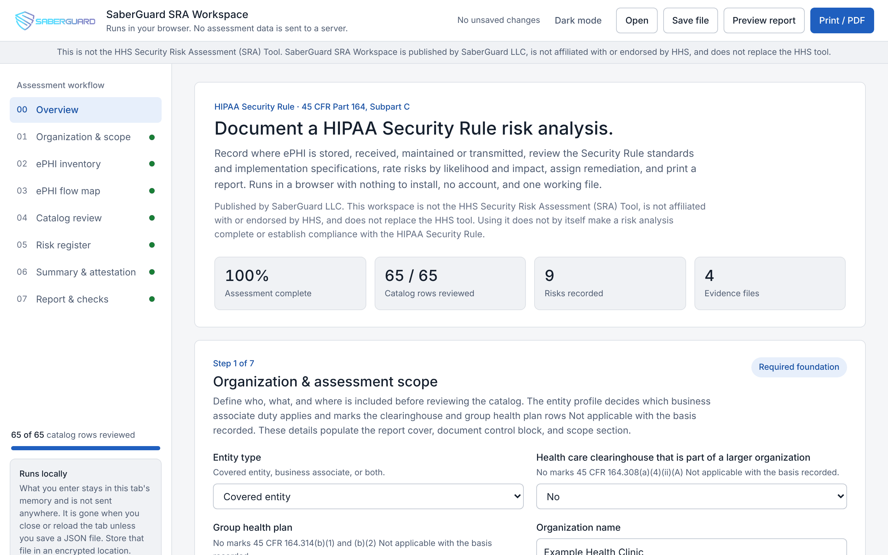
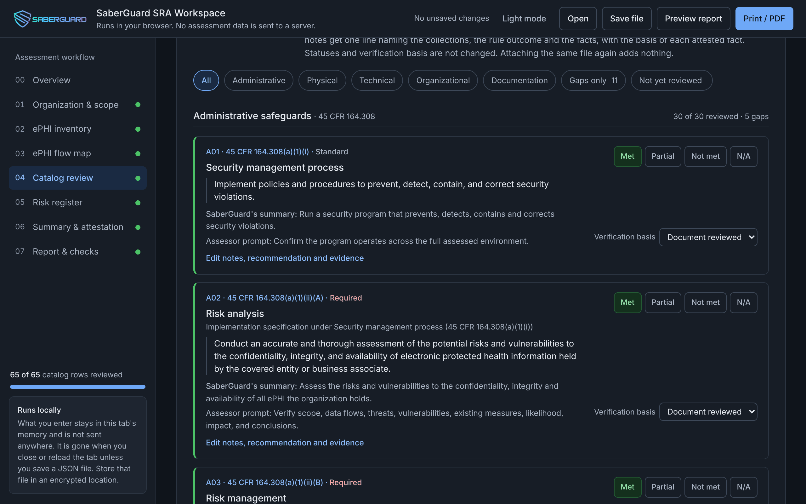
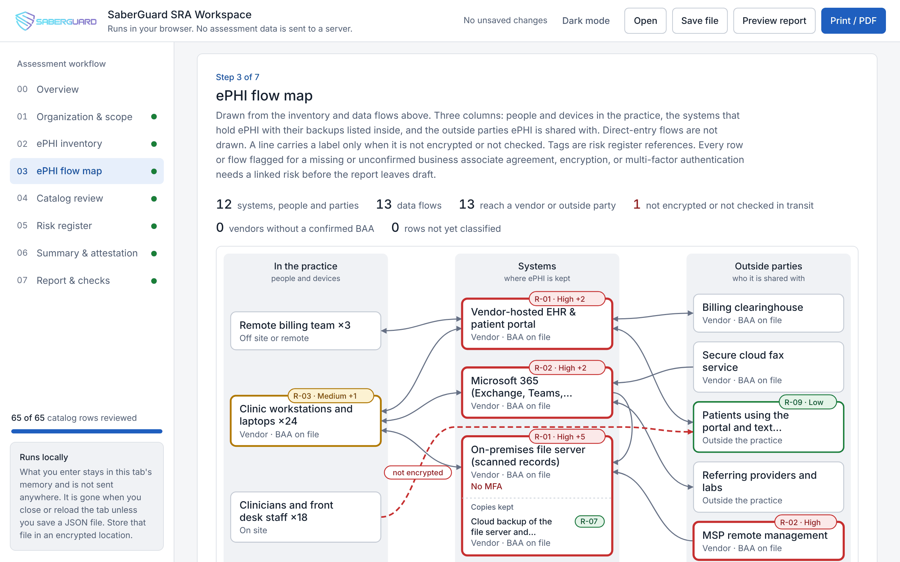
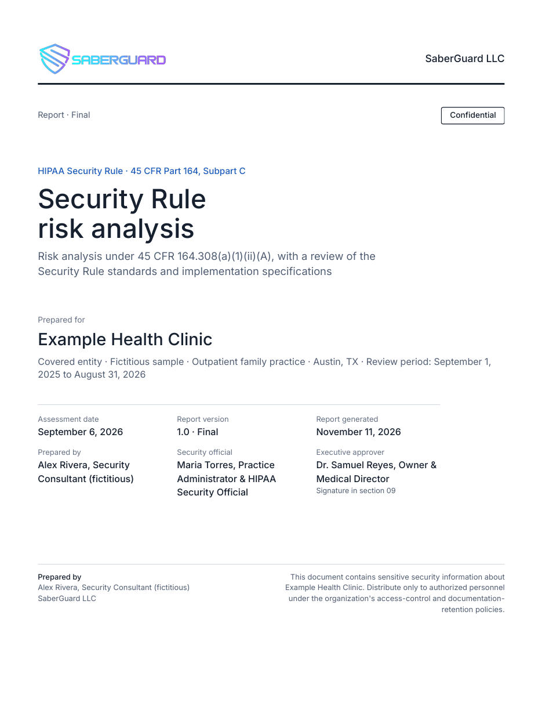
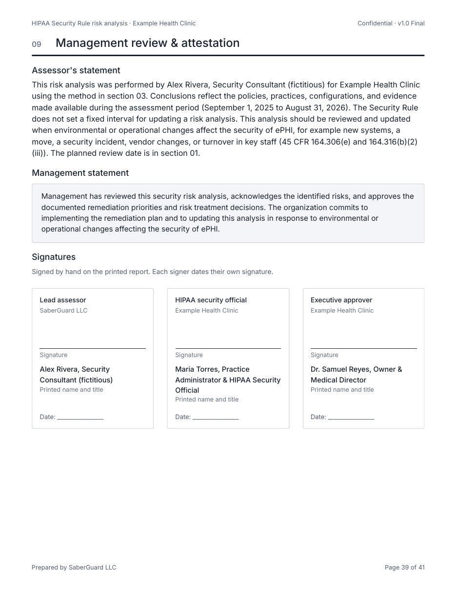

<p align="center">
  
</p>

<h1 align="center">SaberGuard SRA Workspace</h1>

<p align="center">
  A browser workspace for documenting a HIPAA Security Rule risk analysis.<br>
  Inventory where ePHI lives, review the Security Rule row by row beside its own text, rate the risks, and print a report laid out for signature.
</p>

<p align="center">
  <a href="https://saberguard-llc.github.io/HIPAA-SRA-Tool/"><b>Open the workspace</b></a> ·
  <a href="https://saberguard-llc.github.io/HIPAA-SRA-Tool/docs/"><b>Docs</b></a> ·
  <a href="CHANGELOG.md"><b>Changelog</b></a> ·
  <a href="VERIFICATION.md"><b>Sources</b></a>
</p>

<p align="center">
  <a href="https://github.com/SaberGuard-LLC/HIPAA-SRA-Tool/actions/workflows/checks.yml"></a>
  <a href="https://github.com/SaberGuard-LLC/HIPAA-SRA-Tool/actions/workflows/codeql.yml"></a>
  <a href="package.json"></a>
  <a href="LICENSE"></a>
  <a href="https://github.com/SaberGuard-LLC/HIPAA-SRA-Tool/commits/main"></a>
  <a href="VERIFICATION.md"></a>
  
</p>

---

This is not the HHS Security Risk Assessment (SRA) Tool. It is published by SaberGuard LLC, is not affiliated with or endorsed by HHS, OCR, or ONC, and does not replace the [HHS SRA Tool](https://www.healthit.gov/topic/privacy-security-and-hipaa/security-risk-assessment-tool). HHS states that use of its own tool is neither required by nor guarantees compliance with federal, state or local laws. The same is true of this one.

1. Open <https://saberguard-llc.github.io/HIPAA-SRA-Tool/>, or clone this repository and open `index.html`. There is nothing to install and no account.
2. Download [`samples/example-health-clinic-hipaa-sra-2026-09-06.json`](samples/example-health-clinic-hipaa-sra-2026-09-06.json), press **Open**, and choose it to see a finished, fictitious assessment.
3. Press **Preview report**, then **Print / PDF**.

<p align="center">
  
</p>

| Catalog review, dark theme | ePHI flow map |
| --- | --- |
|  |  |
| **Report cover on letterhead** | **Signature page** |
|  |  |

## What each step produces

| Step | What you get |
| --- | --- |
| **Organization and scope** | The organization, review period, method, and the entity profile. The profile marks the rows that do not apply (clearinghouse, group health plan, subcontractor contracts) as Not applicable, with the basis recorded. |
| **ePHI inventory** | Every person, device, system, outside party, and backup that stores, receives, maintains, or transmits ePHI, and the data flows between them. Each row records vendor, business associate agreement, location, encryption at rest, and multi-factor authentication. |
| **ePHI flow map** | Drawn from the inventory. Three columns, a label only on flows that are not encrypted or not checked, and one tag per finding. The same file always produces the same drawing. |
| **Catalog review** | 65 rows: the standards and implementation specifications in 45 CFR 164.308, 164.310, 164.312, 164.314, and 164.316. Each shows the regulation's own wording, a status, how the status was verified, notes, a recommendation, and evidence. |
| **Risk register** | Likelihood and impact from 1 to 5, a treatment decision, owner, target date, and residual rating. Each risk links to the inventory rows, flows, and catalog rows it affects. |
| **Summary and attestation** | The executive summary, written by the assessor or generated from the results, the named executive approver, and the management statement. |
| **Report** | Cover, document control, executive summary, findings, risk register, remediation roadmap, and a signature page. Prints on your letterhead or on pre-printed letterhead paper, with page numbers, and carries a Draft watermark until the completeness checks pass and the report status is set to Final. |

The workspace also has light and dark themes, a risk scenario library, and an import for evidence files from SaberGuard Ward, a separate product. Files from earlier versions open without loss.

## What it is not

It is not a scanner, it does not test systems, and it does not decide anything. It records the assessor's work and judgment. Using it does not by itself make a risk analysis complete, and it does not establish compliance with the HIPAA Security Rule. It is not legal advice.

## Where your data goes

Nowhere. The page makes no network connection. A Content Security Policy sets `connect-src 'none'`, so the browser blocks `fetch`, `XMLHttpRequest`, WebSocket, and beacon calls, and it loads scripts, fonts, and stylesheets only from the page's own origin. It sets no cookies and uses no `localStorage`, `sessionStorage`, or IndexedDB. Work stays in the tab's memory until you save a JSON file or print.

The saved file and the printed report describe an organization's security weaknesses. Store them only in an approved, encrypted location, and do not attach evidence that shows patient identifiers. See [data handling](https://saberguard-llc.github.io/HIPAA-SRA-Tool/docs/data-handling/).

## How the regulation text is checked

Every catalog row carries the regulation's own wording and, separately, a plain-language summary labelled as SaberGuard's. A test compares the wording, heading, and Required or Addressable marker on all 65 rows with the official eCFR text of 45 CFR Part 164, Subpart C kept in `tests/fixtures/`, and fails if the regulation has a standard or titled specification the catalog lacks.

The text was last retrieved on November 11, 2026 (eCFR issue of November 5, 2026). Subpart C was last amended on November 24, 2020. The changes HHS proposed in January 2025 (90 FR 898) are not final, so the workspace reflects the rule in force.

Every regulatory statement that ships is listed in [VERIFICATION.md](VERIFICATION.md) with its source and the date it was checked. Two of them, which rest on OCR's risk analysis guidance, are marked unconfirmed there because hhs.gov could not be read on that date.

## Catalog row count, addressable specifications, and scoring

The catalog has one row per standard, one row per titled implementation specification, and one row for the untitled implementation specifications paragraph at 45 CFR 164.314(b)(2). 164.308(b)(1) is counted as a standard because Appendix A to Subpart C lists it as one; 164.308(b)(2) has no heading and is shown with it. Under this convention there are 65 catalog rows: 22 standards, 21 Required implementation specifications, and 22 Addressable implementation specifications. The regulation itself states no total. The count is SaberGuard's convention. Every displayed count is derived from the catalog.

An addressable implementation specification is not optional. The covered entity or business associate must assess whether it is reasonable and appropriate in its environment; implement it if it is; and if it is not, document why and implement an equivalent alternative measure if one is reasonable and appropriate (45 CFR 164.306(d)(3)). The workspace records this with two statuses available on addressable rows only: "Alternative measure in place" and "Not implemented, decision documented". Both need a note.

The 1 to 5 rating scales, the Low, Medium, and High thresholds, and the implementation score are also SaberGuard's own. The score is a progress measure, not a compliance score. The Security Rule sets no fixed interval for a risk analysis, so "Next planned review" is a date the organization sets. See [the catalog and scoring](https://saberguard-llc.github.io/HIPAA-SRA-Tool/docs/catalog/).

## Printing and signing

1. Finish the completeness checks and set the report status to Final.
2. In step 7, choose a letterhead: your firm's, printed by the report, or blank space for pre-printed paper.
3. Press **Print / PDF**. Paper size Letter, margins Default, browser headers and footers off.
4. Sign by hand in section 09.

Print from Chrome or Edge to get "Page 2 of 41" numbering in the page margins. See [report and printing](https://saberguard-llc.github.io/HIPAA-SRA-Tool/docs/report/).

## Development

Run the text lint and the tests (Node 22 or later):

```bash
npm run check
```

There are no dependencies and no build step. The repository layout, the design rules, and how to refresh the regulation text are in [development](https://saberguard-llc.github.io/HIPAA-SRA-Tool/docs/development/).

A host that serves its own copy can keep assessments for its users through `window.SRA.snapshot()`, `importAssessment()`, and `markSaved()`. See [file format and hosting](https://saberguard-llc.github.io/HIPAA-SRA-Tool/docs/file-format/).

## References

- [45 CFR Part 164, Subpart C](https://www.ecfr.gov/current/title-45/subtitle-A/subchapter-C/part-164/subpart-C)
- [HHS OCR Guidance on Risk Analysis](https://www.hhs.gov/hipaa/for-professionals/security/guidance/guidance-risk-analysis/index.html)
- [HHS Security Risk Assessment (SRA) Tool](https://www.healthit.gov/topic/privacy-security-and-hipaa/security-risk-assessment-tool)

## License

Code is released under the [MIT License](LICENSE). The SaberGuard name and logo are not covered by that license. The bundled Inter font is under the SIL Open Font License; see `assets/fonts/LICENSE-Inter`.
